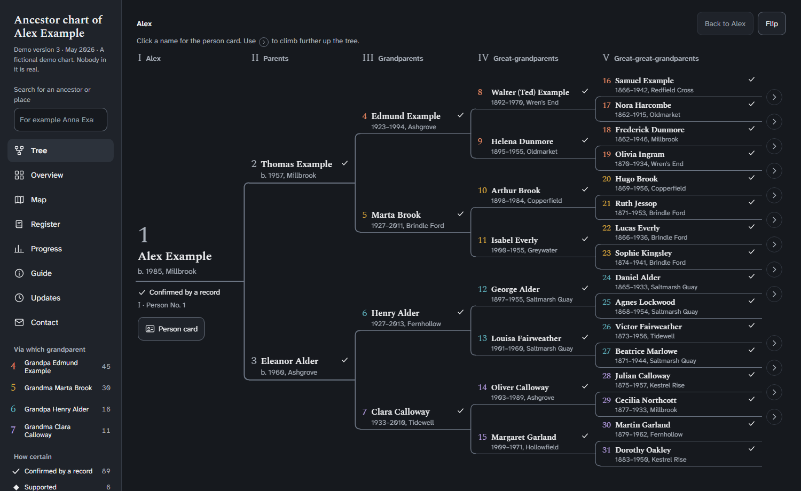
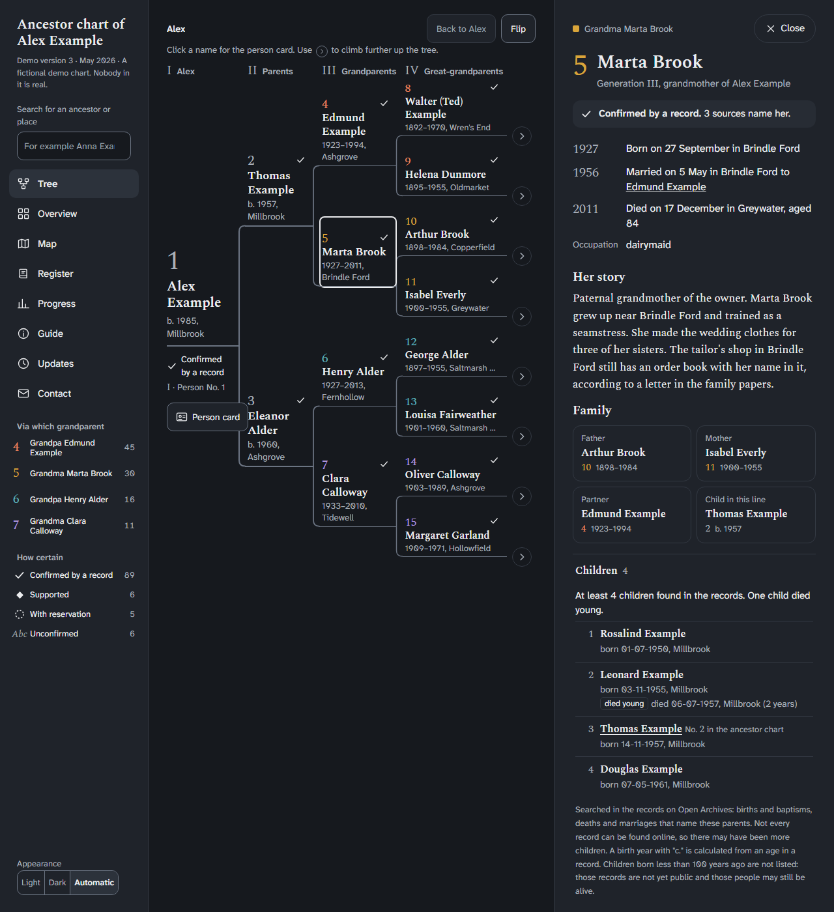
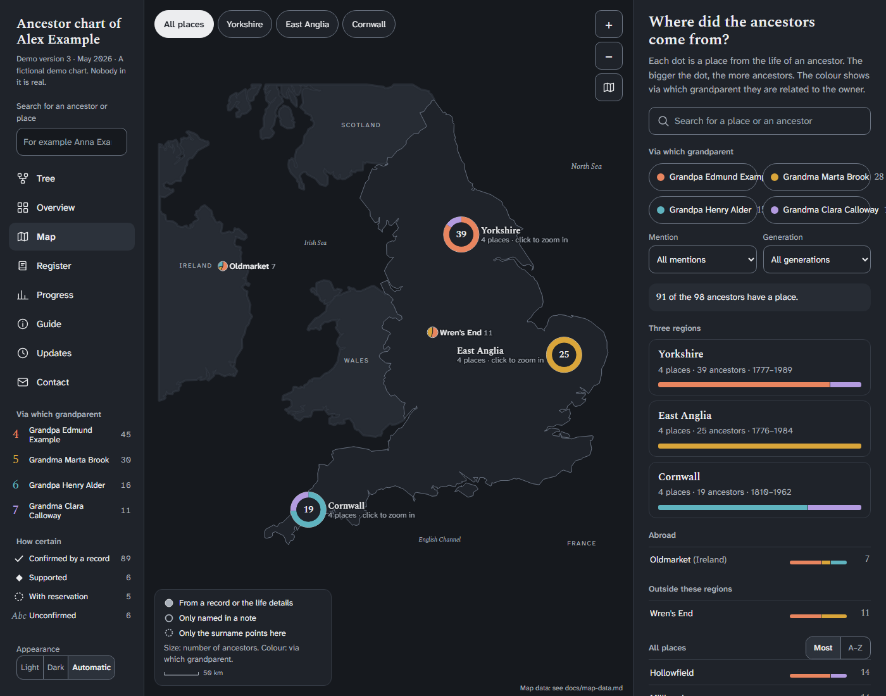
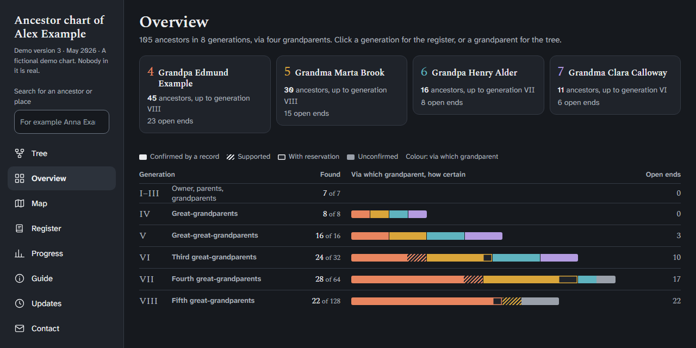
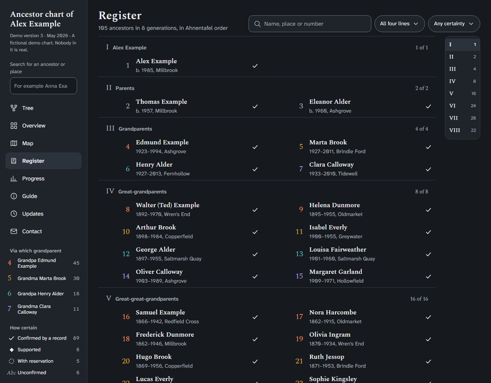
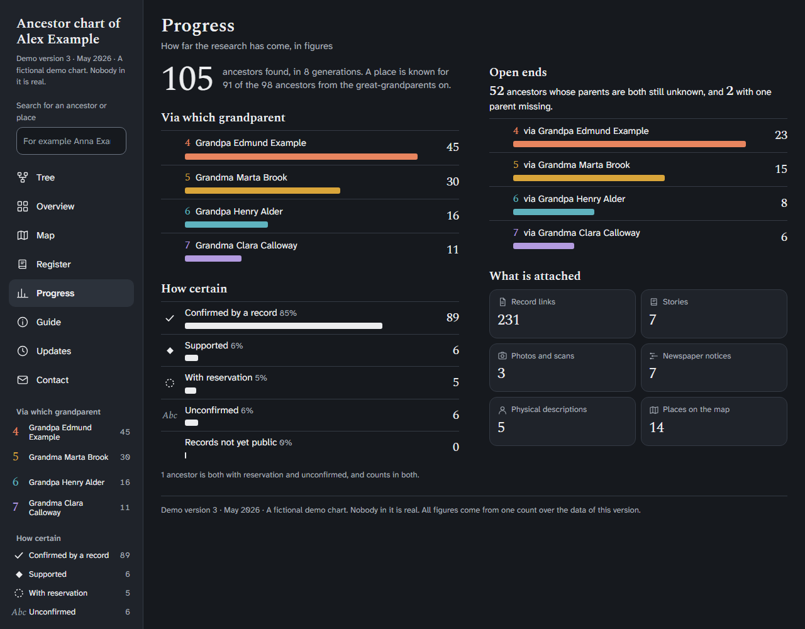
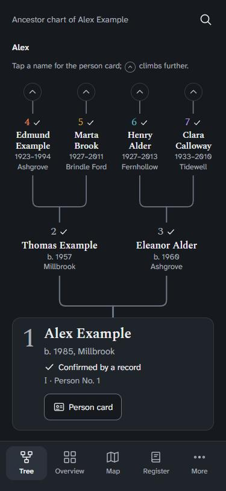
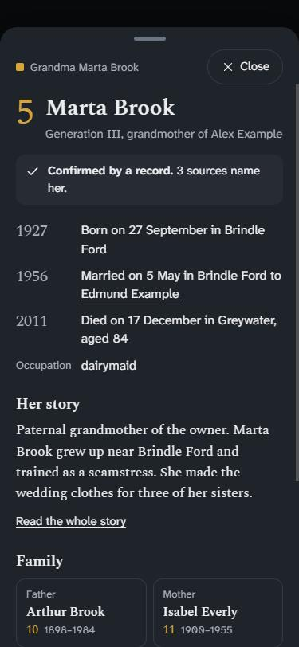
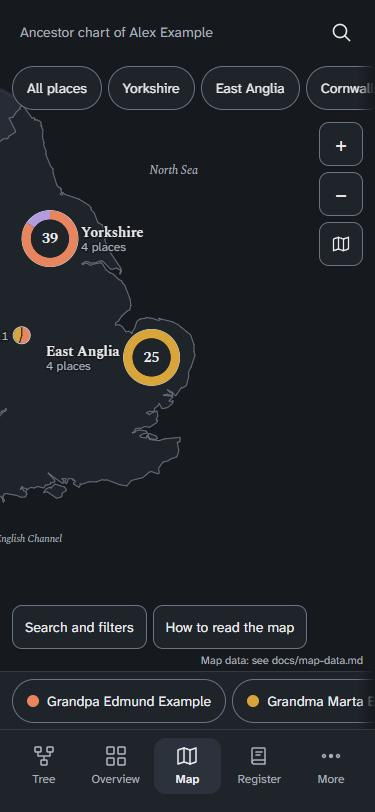
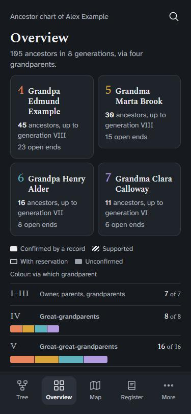

# OpenRoots

A free, open-source ancestor chart (Ahnentafel) you can host anywhere, with an agent workflow
for researching your ancestors in free and open archives. No account, no subscription, no paywall.

OpenRoots is two things:

1. **A chart app.** One self-contained HTML file with a tree, a register, an overview, a map,
   a progress page and a person card for every ancestor. It shows how certain each fact is,
   in shapes and words rather than colour alone. It works on phones, tablets and laptops,
   in light and dark mode, and offline once opened.
2. **An agent skill, `ancestor-research`.** Instructions and tools that let an AI agent search
   free archives, cite what it finds, grade the evidence, and hand back results you can check. See
   [Fill your chart with AI agents](#fill-your-chart-with-ai-agents).

This repository is a **template**. It contains no family data. You bring your own.

## What it looks like

These screenshots come from the fictional demo chart in `examples/demo/`. Nobody in it is real, and the
map shows England with invented villages. Your own chart looks the same, with your own people.

**The tree.** A pedigree diagram. Click a name for the person card, and use the arrows to climb further up.



**The person card.** Life events, sources, a story, family and children. It shows how sure each fact is.



**The origins map.** Where the ancestors came from, by region and by grandparent line.



**The overview.** Every generation as a bar: colour shows the grandparent line, fill shows how certain.



**The register.** Everyone in Ahnentafel order, with search and filters.



**Progress.** The figures, the open ends and what is attached.



**On a phone.** The tree stands upright, with the person at the bottom and the ancestors branching upwards.

<p>




</p>

Build the demo yourself with `node build.mjs --data examples/demo --out dist/demo.html`.

## What it replaces, and what it does not

OpenRoots is meant as a free alternative to the part of MyHeritage and Ancestry that people use
most: keeping a chart, seeing how sure each fact is, and finding records. It does this with free and
open sources, such as national and regional archives, open indexes, newspaper archives and
public-domain books.

It does **not** include their private collections, DNA matches or automatic record matching. It
never logs in to a paid service, never scrapes one and never works around a paywall. If the
best record is behind a paywall, the agent notes it as a lead and you decide what to do.

## Quick start

You need [Node.js](https://nodejs.org) 18 or later. There is nothing to install.

```bash
# Look at the fictional demo chart
node build.mjs --data examples/demo --out dist/demo.html
# then open dist/demo.html in your browser

# Start your own chart
cp -r data my-data            # my-data/ is ignored by git
# fill in my-data/*.json, see docs/data-format.md
node build.mjs --data my-data # writes dist/index.html
```

The default `data/` folder holds empty files. When you open a chart with no people, the app
shows its Guide with the steps to add your own.

Keep your own data **out of any public repository**. `my-data/` and `dist/` are listed in
`.gitignore` for that reason. Read [docs/privacy.md](docs/privacy.md) before you publish anything.

## Fill your chart with AI agents

You do not have to write a single data file yourself. Tell an AI agent what you know in plain
words, and let it do the searching and the typing. One user found about 1,000 ancestors in one
week this way.

With Claude Code it goes like this:

1. Copy `skills/ancestor-research/` into `.claude/skills/` in your project, or into
   `~/.claude/skills/` to use it everywhere.
2. Tell the agent what you already know. For example: "I am Alex Example, born in 1985 in
   Millbrook. My father is Thomas Example, my mother is Eleanor Alder. Start my chart in
   my-data." The agent writes the data files for you.
3. Ask for research: "Use the ancestor-research skill to find the parents of No. 4." Or think
   bigger: "Work through generation 5 and find what the free archives hold for each person."
   The agent can split the work over sub-agents, one family line each.
4. Read the one-page report. Every finding has a source link and a grade: confirmed, probable,
   possible or unverified.
5. Say what to keep: "Add the confirmed and probable findings to my chart and rebuild it."
6. Open `dist/index.html`, or have Claude publish it as an artifact (see below).

Repeat steps 3 to 5 for each generation. Every round the chart grows, and its open ends show
where to search next.

It goes fast because the agent searches archive indexes in seconds, follows each new name on to
the next generation, and logs every search, so nothing is done twice. It stays reliable because
every fact needs a source the agent actually opened, and the chart shows how sure each one is.
You stay in charge of what goes in.

Your chart may end up with details about living relatives, found by you or by the agent. That is
fine in a file you keep. Be careful who you share it with, and read [docs/privacy.md](docs/privacy.md)
first.

How fast it goes for you depends on your region. Dutch records are very well indexed for free:
the skill's helper script reads the free Open Archives API, which holds mostly Dutch records.
For other countries the skill points to the best free sources per country, listed in
[references/regions.md](skills/ancestor-research/references/regions.md).

Behind the scenes the agent writes a research log, a cited `findings.json` and a one-page report
for each question, and checks them with the bundled validator.

## Make it a Claude artifact

The built chart is one HTML file that needs nothing else, so it also works as a
[Claude](https://claude.ai) artifact: a page that Claude hosts for you and that stays private until
you share it.

1. Build your chart with your own data, as above. That gives you `dist/index.html`.
2. Open Claude Code, or the Code tab of the Claude desktop app, in this folder.
3. Ask: "Publish dist/index.html as an artifact." Claude uploads the file as it is and gives you
   a link to the page.
4. To update the chart later, change your data, build again and ask Claude to update the artifact.
   Give it the link, so the address stays the same.

Use Claude Code for this step. In a regular chat on claude.ai, Claude would have to write the whole
page out itself, and the app is usually too large for that.

Before you share the link, read [docs/privacy.md](docs/privacy.md). Anyone you share it with can
read every name, date and note in the chart.

## Documentation

| | |
|---|---|
| [docs/data-format.md](docs/data-format.md) | Every data file, field and token |
| [docs/config.md](docs/config.md) | Title, owner, contact and other settings |
| [docs/architecture.md](docs/architecture.md) | How the app is built: build, modules, views, statuses |
| [docs/map-data.md](docs/map-data.md) | How the map works and what it needs |
| [docs/glossary.md](docs/glossary.md) | The words used in the interface |
| [docs/privacy.md](docs/privacy.md) | Living people, sensitive facts, and publishing safely |
| [skills/ancestor-research](skills/ancestor-research/README.md) | The agent skill |
| [AGENTS.md](AGENTS.md) | Start here if you are an AI agent |

## Status and known limits

This is an early version. Parts of the code were first written in Dutch.

- The interface is English. Some internal names in the code, such as class names, routes and data
  tokens, are still Dutch. They work, and [docs/data-format.md](docs/data-format.md) lists them.
  Renaming them is a planned cleanup.
- The map works for any country. A script builds the outline from public-domain data, and the demo
  shows England. The historical context events in `C` are yours to write. See
  [docs/map-data.md](docs/map-data.md).
- The sample data is entirely fictional.

## Contributing

Bug reports, regional source lists, translations of the interface and cleanups of the Dutch
identifiers are welcome. See [CONTRIBUTING.md](CONTRIBUTING.md). Never include real personal
data in an issue or a pull request.

## Licence

[MIT](LICENSE). Fonts (Atkinson Hyperlegible Next and Spectral) are loaded from Google Fonts under
the SIL Open Font Licence.
